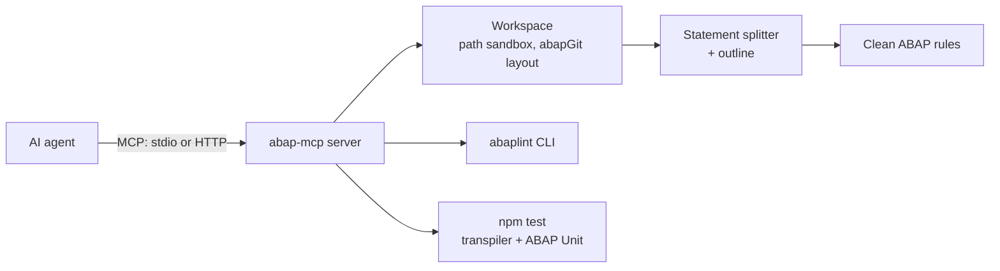

# abap-mcp

[](https://github.com/jakkwi/abap-mcp/actions/workflows/ci.yml)


An [MCP](https://modelcontextprotocol.io) server that lets AI coding agents **read, review and test ABAP code without an SAP system**.

AI coding agents are good at Python and TypeScript because they can explore a codebase, run a linter and run the tests. ABAP code usually lives inside an SAP system, so an agent gets none of that. It writes code blind, and a human finds the problems after a transport.

abap-mcp closes that gap for code stored as [abapGit](https://abapgit.org) files. An agent (Claude, GitHub Copilot, Kilo Code, Cline...) can list the objects in a repository, outline a class before changing it, review its own output against Clean ABAP, run full static analysis, and execute ABAP Unit tests, all on a laptop.

## Tools

| Tool | What the agent gets | Needs |
| --- | --- | --- |
| `list_objects` | Every class, interface and program in an abapGit folder, with its files | Python |
| `outline_object` | Methods with visibility and full signature, attributes, test classes, and the line range of every method body | Python |
| `check_conventions` | A fast Clean ABAP review of a snippet or an object. Each finding has a fix and cites the [style guide](https://github.com/SAP/styleguides/blob/main/clean-abap/CleanABAP.md) section | Python |
| `lint` | Full static analysis with [abaplint](https://abaplint.org): syntax, types, obsolete statements, naming | Node.js |
| `run_tests` | ABAP Unit tests executed on Node.js through the abaplint transpiler, with pass/fail counts and failing test names | Node.js |

The rule catalog is also exposed as the MCP resource `abap-mcp://rules`.

## Example

The agent has just written this and asks for a review before saving it:

```abap
METHOD calculate.
  DATA lv_sum TYPE i.
  MOVE iv_amount TO lv_sum.
  IF NOT lv_sum IS INITIAL.
    ev_total = lv_sum.
  ENDIF.
ENDMETHOD.
```

`check_conventions` answers with something the agent can act on directly:

```json
[
  { "rule": "no-hungarian-notation", "line": 2,
    "message": "'lv_sum' encodes its scope or type in a prefix",
    "suggestion": "Name it for what it holds, e.g. 'sum'" },
  { "rule": "no-obsolete-statements", "line": 3,
    "message": "'MOVE' is obsolete", "suggestion": "Use an assignment: target = source." },
  { "rule": "prefer-is-not", "line": 4,
    "message": "Negation placed before the operand", "suggestion": "Write 'lv_sum IS NOT ...'" }
]
```

Then `run_tests` on a project like [jakkwi/SAP](https://github.com/jakkwi/SAP) returns `{"passed": true, "tests_passed": 21, "tests_total": 21, ...}`. The agent has verified its change without anyone opening SAP GUI.

## Quick start

Requires Python 3.11+. Node.js 20+ is optional and enables `lint` and `run_tests`.

```bash
pipx install git+https://github.com/jakkwi/abap-mcp
# or run it without installing:
uvx --from git+https://github.com/jakkwi/abap-mcp abap-mcp --root path/to/abap/repo
```

### Connect an agent

**Claude Code**

```bash
claude mcp add abap -- abap-mcp --root /path/to/abap/repo
```

**Claude Desktop, Kilo Code, Cline** (`mcpServers` in the client's MCP settings file):

```json
{
  "mcpServers": {
    "abap": {
      "command": "abap-mcp",
      "args": ["--root", "/path/to/abap/repo"]
    }
  }
}
```

**VS Code with GitHub Copilot** (`.vscode/mcp.json`):

```json
{
  "servers": {
    "abap": { "command": "abap-mcp", "args": ["--root", "${workspaceFolder}"] }
  }
}
```

To share one server across a team, run it over HTTP instead of stdio:

```bash
abap-mcp --root /srv/abap --http --host 0.0.0.0 --port 8000   # endpoint: /mcp
# or
docker build -t abap-mcp . && docker run -p 8000:8000 -v "$PWD:/workspace" abap-mcp
```

## How it works



- **Statement splitter** (`source.py`). ABAP statements end with a period, except when the period sits in a string literal, a string template, a comment or a member access. A single pass with explicit state handles all of these, keeps line numbers, and attaches ABAP Doc comments to the statement they document.
- **Outline** (`outline.py`). Turns statements into classes, interfaces, methods and attributes. The signature parser knows that in `IMPORTING a TYPE REF TO zif_x b TYPE STANDARD TABLE OF t WITH EMPTY KEY` the parameters are `a` and `b`, not `zif_x` or `t`.
- **Rules** (`rules.py`). Each rule is a small generator registered with a decorator, so adding a check is one function and one test.
- **Workspace** (`workspace.py`). Every path arrives from a language model, so it is untrusted. Paths are resolved and must stay inside the root the server was started with: `../`, absolute paths and symlinks pointing outside are refused.
- **Toolchain** (`tooling.py`). Runs abaplint and npm as subprocesses with timeouts and without a shell. When Node.js is missing, the result says so and the pure-Python tools keep working.

## Design decisions

- **Two levels of checking.** `check_conventions` is instant and works on a snippet that has not been saved yet, which suits an agent iterating in a loop. `lint` is slower, needs Node.js and understands types. Agents use the first constantly and the second before finishing.
- **Errors are results, not exceptions.** An unknown object or a bad path comes back as `{"error": "..."}`, so the agent can correct itself instead of failing the whole call.
- **Read-only by default.** Every tool except `run_tests` carries the MCP `readOnlyHint`, so clients can auto-approve them.
- **No SAP system, no vendor code.** Everything runs on open-source tooling. All sample ABAP in this repository is original.

## Development

```bash
pip install -e ".[dev]"
pytest              # 46 tests; the abaplint tests run when Node.js is available
ruff check . && ruff format --check .
mypy src            # strict
```

The tests drive the server through a real MCP client, the same way an agent does.

## Roadmap

- Read objects directly from an SAP system over the ADT REST API, as an optional backend
- More rules: magic numbers, nested IF depth, SELECT in loops
- Quick fixes returned as text edits the agent can apply

## License

MIT. See [LICENSE](LICENSE).
