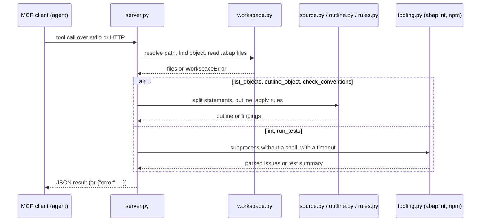

# Architecture

abap-mcp is a single Python package that serves ABAP analysis tools over the Model Context Protocol (MCP). It reads ABAP code from abapGit files on disk. It never connects to an SAP system.

## Components

| Module | What it does |
| --- | --- |
| [`__main__.py`](../src/abap_mcp/__main__.py) | Command line entry point `abap-mcp`. Parses `--root`, `--http`, `--host`, `--port`, `--version` and starts the server on stdio or Streamable HTTP. |
| [`server.py`](../src/abap_mcp/server.py) | Builds the MCP server, registers the five tools and the `abap-mcp://rules` resource, and turns workspace errors into `{"error": "..."}` results. |
| [`workspace.py`](../src/abap_mcp/workspace.py) | The path sandbox and the abapGit layout. Resolves every model-supplied path inside the workspace root, finds the source folder, groups files into ABAP objects. |
| [`source.py`](../src/abap_mcp/source.py) | Splits ABAP source into statements, aware of string literals, string templates, comments and ABAP Doc. |
| [`outline.py`](../src/abap_mcp/outline.py) | Turns statements into classes and interfaces with methods, signatures, attributes and method body line ranges. |
| [`rules.py`](../src/abap_mcp/rules.py) | The Clean ABAP rule catalog. Each rule is a generator registered with the `@rule` decorator and cites a style guide section. |
| [`tooling.py`](../src/abap_mcp/tooling.py) | Runs the optional Node.js tools (abaplint, npm) as subprocesses and parses their output. |

The pure-Python modules (`workspace`, `source`, `outline`, `rules`) have no dependency besides the standard library. The only runtime dependency of the package is the MCP Python SDK (`mcp`).

## Tools and what they call

| Tool or resource | Annotations | Calls |
| --- | --- | --- |
| `list_objects(path)` | read-only | `Workspace.objects` |
| `outline_object(object_name, path)` | read-only | `Workspace.find`, `Workspace.read_source`, `outline` |
| `check_conventions(source \| object_name, path, max_method_statements)` | read-only | `rules.check` on the snippet or on every `.abap` file of the object |
| `lint(source, path)` | read-only | `tooling.lint_source` for a snippet, `tooling.lint_project` for a folder |
| `run_tests(path, install)` | not read-only, open world | `tooling.run_tests` |
| resource `abap-mcp://rules` | | the `rules.RULES` catalog as JSON |

`check_conventions` needs exactly one of `source` or `object_name`. `run_tests` is the only tool without the read-only hint, because `npm install` and `npm test` write to the project folder and can reach the network.

## Request flow

1. The client sends a tool call. Every path argument is relative to the workspace root.
2. `Workspace.resolve` resolves the path and refuses it when it lands outside the root (`../`, absolute paths, symlinks pointing out). A refused path or an unknown object raises `WorkspaceError`, which `server.py` returns as `{"error": "..."}`.
3. `Workspace.source_folder` picks the folder holding the serialised objects: the `STARTING_FOLDER` from `.abapgit.xml` when it exists and stays inside the root, otherwise `src/` when present, otherwise the project folder itself.
4. `Workspace.objects` matches file names like `zcl_order_total.clas.testclasses.abap` and groups them by object name and type. A `#` in a file name becomes `/` in the object name (namespaces).
5. Analysis tools pass the `.abap` text to `source.split_statements`, then to `outline` or `rules.check`.
6. Node.js tools hand a folder to `tooling.py`, which runs the command and parses its output into a dict.

## Node.js tooling

| Tool | Command | Working folder | Notes |
| --- | --- | --- | --- |
| `lint` with `source` | `abaplint <config> --format json` | a temporary folder holding the snippet and the default config | the file name is derived from the first `CLASS` or `INTERFACE` statement |
| `lint` on a project with `abaplint.json` | same | the project folder | the project's own config is used |
| `lint` on a project without one | same | a temporary copy of the source folder | the default config in `DEFAULT_LINT_CONFIG` is used |
| `run_tests` | `npm ci` or `npm install` (only when `node_modules` is missing or `install` is true), then `npm test` | the project folder | needs a `package.json`; the result keeps the last 4000 characters of output |

abaplint is found in this order: the `ABAP_MCP_ABAPLINT` command, an `abaplint` on `PATH`, then `npx --yes @abaplint/cli@2`. The npx fallback downloads the package from npm on first use. When none is available, `lint` returns `"available": false` and the pure-Python tools keep working.

`run_tests` expects a project that runs ABAP Unit on Node.js through the abaplint transpiler, such as [jakkwi/SAP](https://github.com/jakkwi/SAP). It reads pass counts and failing test names from the `npm test` output.

## Configuration

| Setting | Default | Effect |
| --- | --- | --- |
| `--root DIR` | `$ABAP_MCP_ROOT`, else the current directory | Workspace root. Every tool path is resolved inside it. |
| `--http` | off (stdio) | Serve Streamable HTTP instead of stdio. |
| `--host`, `--port` | `127.0.0.1`, `8000` | HTTP bind address. |
| `ABAP_MCP_TIMEOUT` | `180` | Timeout in seconds for abaplint. Each npm step gets three times this value. |
| `ABAP_MCP_ABAPLINT` | unset | Command used to run abaplint, split on spaces. |

The server adds no authentication of its own. Over HTTP, anyone who can reach the port can call the tools, so keep the default `127.0.0.1` binding unless the network is trusted.

## External services and contracts

| Contract | Where |
| --- | --- |
| MCP over stdio or Streamable HTTP, through the MCP Python SDK (`mcp>=2.0,<3`) | `server.py`, `__main__.py` |
| abapGit file layout and `.abapgit.xml` `STARTING_FOLDER` | `workspace.py` |
| abaplint CLI JSON output (`key`, `description`, `file`, `start.row`, `start.col`, `severity`) | `tooling.py` |
| `npm test` output lines `N/M tests passed` and `FAIL <name>` | `tooling.py` |
| Clean ABAP style guide section titles, cited by each rule | `rules.py` |

No SAP system, ADT API or SAP service is contacted. The only network access happens inside Node.js tooling: the npx fallback for abaplint and whatever `npm install` or `npm test` does in the project.

## Docker image

The [`Dockerfile`](../Dockerfile) builds on `python:3.13-slim`, installs Node.js, npm and `@abaplint/cli@2`, and runs as an unprivileged user. It serves HTTP on port 8000 with `/workspace` as the root, so mount the ABAP repository there.

## Tests

The tests in [`tests/`](../tests) work on a small abapGit project in `tests/fixtures/shop`. Tests that need a workspace get a temporary copy of it through the `workspace_root` fixture. `test_server.py` drives the server through a real MCP client. Tests that need Node.js and abaplint (or npx) are marked `node` and skipped when those are missing.

## Decisions

The reasons behind the main design choices are recorded as ADRs in [`docs/adr`](adr).
